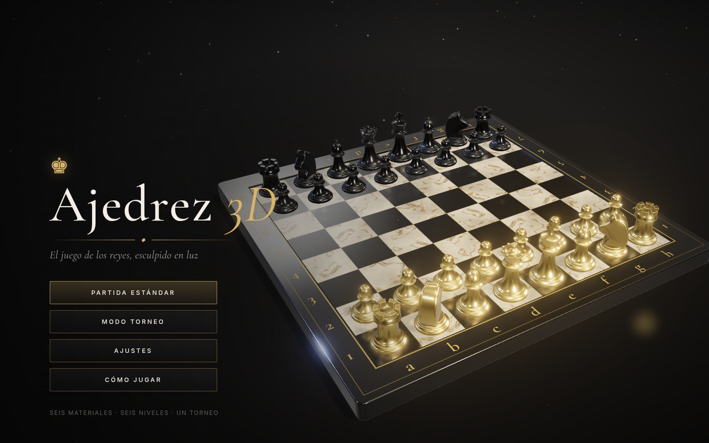
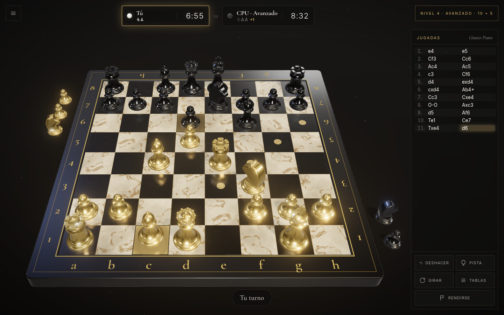
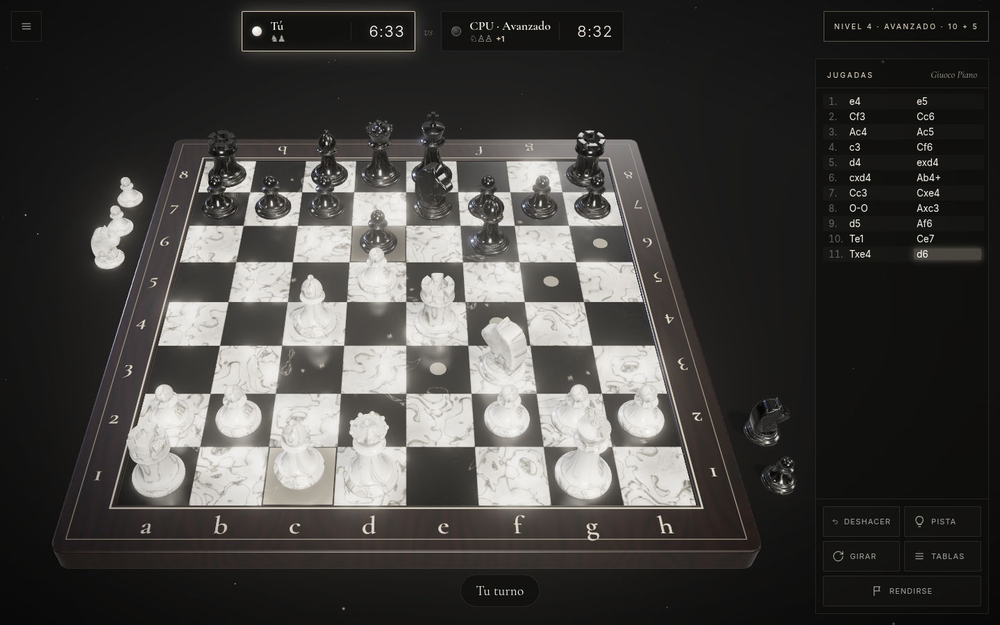
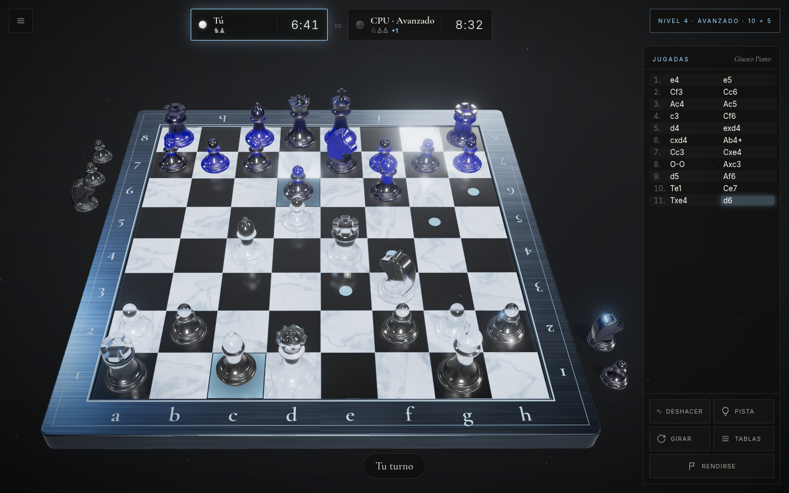
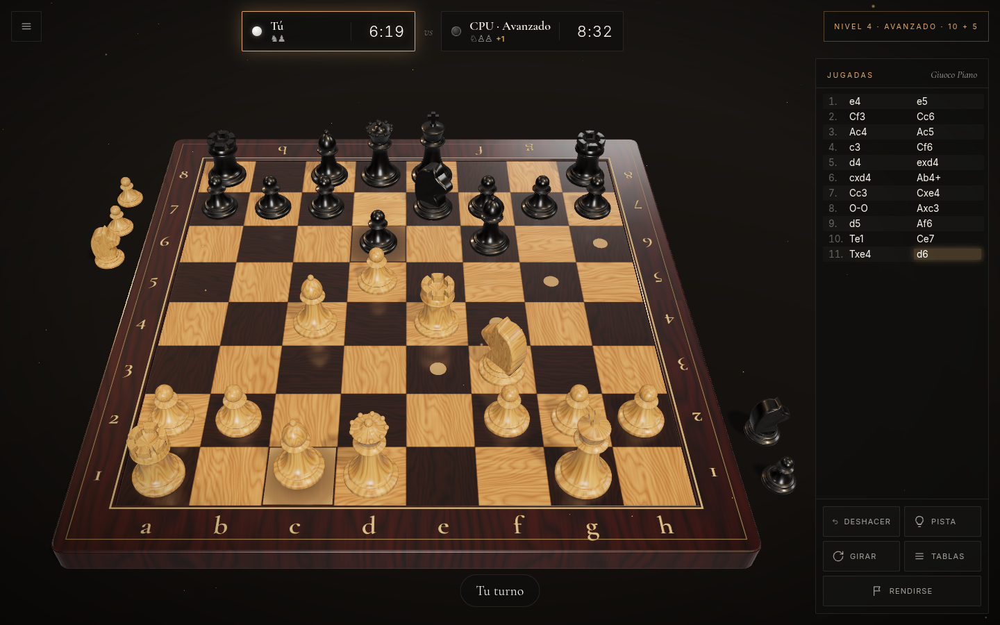
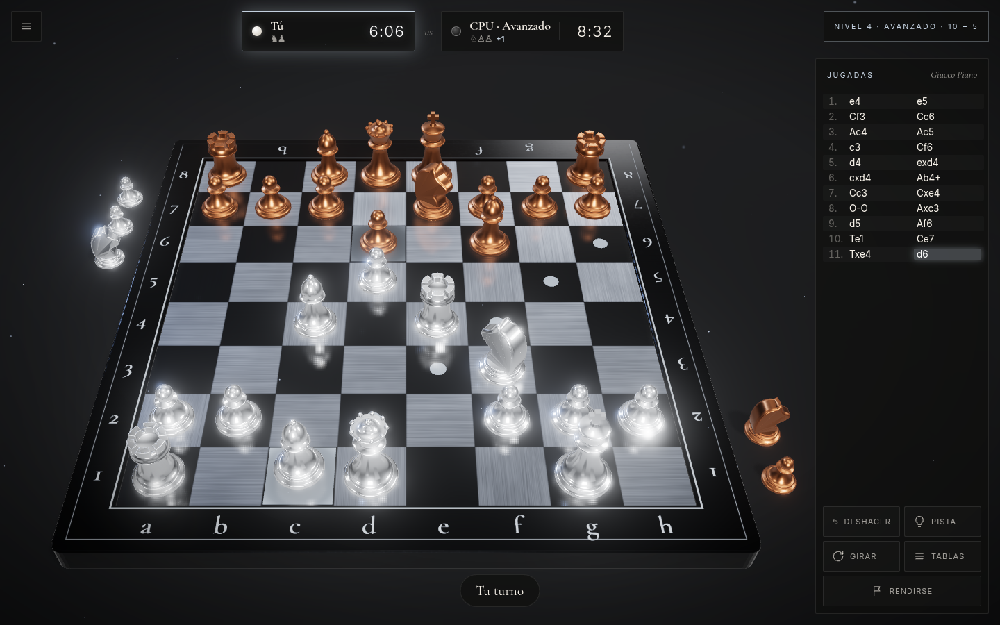
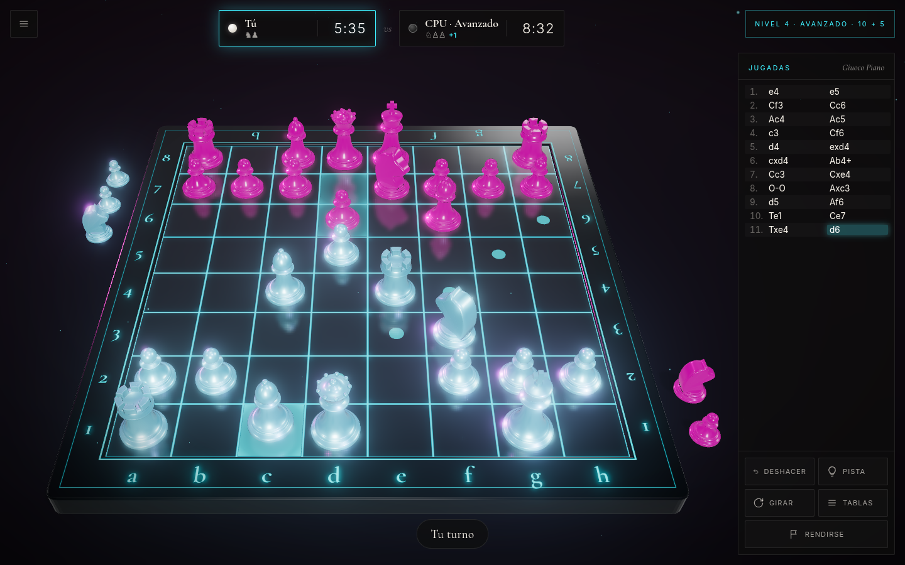

# ♚ Ajedrez 3D — Edición Ébano y Oro

Ajedrez para navegador en 3D, hecho con **Three.js** y un **motor de ajedrez propio** que piensa en un Web Worker.
Piezas modeladas por código, materiales PBR, reflejos reales sobre el tablero, polvo dorado flotando en el aire,
música ambiente sintetizada y un modo torneo con seis rivales. No usa imágenes, modelos ni sonidos externos:
todo se genera al vuelo, y una vez compilado funciona **sin conexión**.



| Ébano y Oro | Mármol de Carrara | Cristal |
|---|---|---|
|  |  |  |
| **Madera Noble** | **Cromo y Bronce** | **Medianoche Neón** |
|  |  |  |

## Características

### Gráficos
- **Seis juegos de materiales**, que se cambian en caliente: Ébano y Oro, Mármol de Carrara, Madera Noble, Cromo y Bronce, Cristal (con transmisión y refracción reales) y Medianoche Neón (con *bloom*).
- **Texturas procedurales** generadas en `<canvas>`: vetas de mármol con deformación de dominio, veta de madera, metal cepillado y laca. El tablero se compone como una taracea, con juntas entre casillas.
- **Piezas estilo Staunton modeladas por código** (`LatheGeometry` + extrusiones): almenas en las torres, cabeza de caballo con crin y ojos, mitra del alfil, corona de la dama con perlas y cruz del rey.
- **Reflejos de verdad**: entorno PBR (`PMREM` + `RoomEnvironment`) y un `Reflector` con desenfoque suave y Fresnel sobre las casillas.
- Sombras suaves, foco cenital, luz de contorno, tono ACES, *bloom* y MSAA.
- **Ambiente**: partículas doradas tipo bokeh, viñeteado y suelo en penumbra.
- **Animaciones**: la cámara entra en espiral al abrir el juego, las piezas caen en cascada al empezar, saltan en arco al moverse (el caballo salta más alto) y se aplastan un poco al aterrizar con una onda de luz. Las piezas capturadas vuelan girando a su bandeja junto al tablero con un estallido de chispas, el enroque mueve también la torre, la coronación hace un destello y una victoria trae lluvia de confeti.
- Se resaltan las jugadas legales (puntos y anillos), la última jugada, el jaque (halo rojo que late) y la pieza seleccionada, que se levanta.

### Juego
- **Reglas completas** (validadas con `chess.js`): enroque, captura al paso, coronación con selector de pieza, jaque mate, rey ahogado, triple repetición, regla de los 50 movimientos y material insuficiente.
- **Modos**: Humano vs CPU y Humano vs Humano en el mismo dispositivo. En este último, la cámara puede girar sola hacia el bando que mueve.
- **Partida estándar** con **reloj opcional**: sin reloj, 3+2, 5+0, 10+5, 15+10 o 30+0, con incremento. Si se agota el tiempo y el rival solo tiene el rey, son tablas.
- **Modo Torneo «Circuito de Campeones»**: seis rivales con nombre, ciudad, Elo y frase propia. Una victoria te pasa de ronda, unas tablas suman medio punto y repites, y una derrota te cuesta una de tus tres vidas. Llevas marcador de puntos, victorias, tablas y derrotas, más un historial de títulos. Todo se guarda en `localStorage`.
- **Extras**: deshacer, pistas del motor, girar el tablero, ofrecer tablas (la CPU decide según su evaluación), rendirse, lista de jugadas en notación algebraica española (R, D, T, A, C), nombre de la apertura, piezas capturadas con ventaja de material, copiar la partida en PGN y guardado automático para **continuar la partida** más tarde.
- **Sonido sintetizado con WebAudio**: golpe de madera, captura, enroque, campanilla de jaque, coronación, acordes de victoria y derrota, sonidos de interfaz y una **música ambiente** suave, todo con reverberación. No hay ningún archivo de audio.

### Motor de ajedrez propio (`src/engine/core.js`)
- Tablero 0x88, generación de jugadas propia **verificada con perft** frente a valores de referencia (posición inicial, Kiwipete y otras).
- Negamax con poda alfa-beta, **PVS**, **profundización iterativa con límite de tiempo** y ventanas de aspiración.
- **Tabla de transposición** con claves Zobrist de 64 bits (2 × 32).
- Ordenación de jugadas por la jugada de la tabla de transposición, MVV-LVA, *killer moves* e historia.
- Poda de movimiento nulo, reducciones tardías (LMR), extensión de jaque, poda por distancia de mate y **búsqueda de quietud** con poda delta.
- Evaluación con material y tablas de casillas interpoladas entre medio juego y final, pareja de alfiles, peones doblados, aislados y pasados, y detección de material insuficiente.
- Corre en un **Web Worker**, así que la interfaz nunca se congela. Se puede cancelar (al deshacer o salir) creando un worker nuevo.

| Nivel | Nombre | Profundidad / tiempo | Comportamiento |
|---|---|---|---|
| 1 | Principiante | 1 · 0,25 s | Mucho ruido y fallos de bulto aleatorios (18 %) |
| 2 | Aficionado | 2 · 0,45 s | Bastante ruido y algún fallo (6 %) |
| 3 | Club | 3 · 0,7 s | Algo de ruido, sin fallos de bulto |
| 4 | Avanzado | 4 · 1,1 s | Ruido ligero |
| 5 | Experto | hasta 7 · 1,8 s | Juega su mejor jugada |
| 6 | Maestro | sin límite · 3,2 s | Profundización completa, su mejor jugada |

Con reloj, la CPU administra su tiempo según lo que le quede y el incremento.

## Cómo ejecutarlo

Necesitas **Node.js 20.19 o superior**.

```bash
npm install
npm run dev        # servidor de desarrollo con recarga en caliente (http://localhost:5173)
npm run build      # compila en dist/
npm run preview    # sirve dist/ para probar el build
npm test           # pruebas del motor: perft, mates y legalidad en los 6 niveles
```

La carpeta `dist/` es estática y usa **rutas relativas** (`base: './'`), así que funciona en cualquier servidor estático
o subcarpeta, por ejemplo `python3 -m http.server -d dist`. Las fuentes (Cormorant Garamond e Inter) van incluidas en el build
mediante `@fontsource`, así que no depende de ningún CDN.

> Abrir `dist/index.html` con doble clic (`file://`) no funciona: los navegadores no permiten cargar módulos ni Web Workers desde `file://`. Usa cualquier servidor estático.

### Capturas automáticas (opcional)
Con el build servido en `http://localhost:4173`, `npm run screenshots` abre el juego en Chrome headless, juega unas jugadas contra la CPU,
comprueba que no haya errores en la consola y guarda capturas en `screenshots/`. Necesita Google Chrome instalado (`CHROME=/ruta/a/chrome` para indicar otro).

## Controles

| Acción | Cómo |
|---|---|
| Mover | Pulsa una pieza y luego la casilla de destino |
| Girar la cámara | Arrastrar con el ratón o el dedo |
| Zoom | Rueda o pellizco |
| Menú / pausa | `Esc` o el botón ☰ |
| Deshacer | `Ctrl` + `Z` (solo en partida estándar) |
| Girar el tablero | `F` |
| Pista | `H` (no disponible en el torneo) |

## Publicar en GitHub Pages

El repositorio incluye `.github/workflows/deploy.yml`, que pasa las pruebas, compila y publica `dist/` en cada *push* a `main`.

1. Sube el repositorio a GitHub (rama `main`).
2. En GitHub, ve a **Settings → Pages → Build and deployment → Source** y elige **GitHub Actions**.
3. Haz un *push* a `main`, o lanza el workflow a mano desde la pestaña **Actions**.
4. El juego quedará en `https://<tu-usuario>.github.io/<repositorio>/`.

> **Repositorio privado**: GitHub Pages en repos privados requiere un plan de pago (GitHub Pro, Team o Enterprise). Con el plan gratuito, el repositorio tiene que ser público para usar Pages. Como alternativa, puedes subir `dist/` a cualquier hosting estático (Netlify, Cloudflare Pages, Vercel…).

**Alternativa manual**, sin Actions: `npm run build` y publica el contenido de `dist/` en una rama `gh-pages`, por ejemplo con `npx gh-pages -d dist`, y elige esa rama en **Settings → Pages**.

## Estructura

```
├── index.html                 # Estructura de menús, HUD y diálogos
├── src/
│   ├── main.js                # Controlador: pantallas, partida, reloj, CPU, torneo, guardado
│   ├── style.css              # Estética: paneles de cristal, botones luminosos, tipografía
│   ├── audio.js               # Efectos y música ambiente con WebAudio
│   ├── engineClient.js        # Cliente del Web Worker (promesas, cancelación)
│   ├── tournament.js          # Circuito de Campeones: rivales, vidas, puntuación
│   ├── openings.js            # Nombres de aperturas en español
│   ├── storage.js             # localStorage seguro
│   ├── engine/
│   │   ├── core.js            # Motor: 0x88, búsqueda alfa-beta, evaluación
│   │   └── worker.js          # Web Worker del motor
│   └── scene/
│       ├── ChessScene.js      # Escena 3D, cámara, animaciones, efectos y selección
│       ├── pieces.js          # Piezas modeladas por código
│       ├── textures.js        # Texturas procedurales (mármol, madera, metal…)
│       └── themes.js          # Los seis juegos de materiales PBR
├── scripts/
│   ├── test-engine.mjs        # Pruebas del motor (perft, mates, legalidad por nivel)
│   └── screenshots.mjs        # Verificación visual con Chrome headless
└── .github/workflows/deploy.yml
```

## Rendimiento

- **Alta**: reflejos, sombras de 2048 px, *bloom* y todas las partículas.
- **Media**: reflejos a menor resolución, sombras de 1024 px y menos partículas. Es la opción por defecto en móviles.
- **Baja**: sin reflejos, sombras ni posprocesado, para equipos modestos.

Créditos: Three.js (MIT), chess.js (BSD-2), fuentes Cormorant Garamond e Inter (SIL OFL), servidas con @fontsource.
